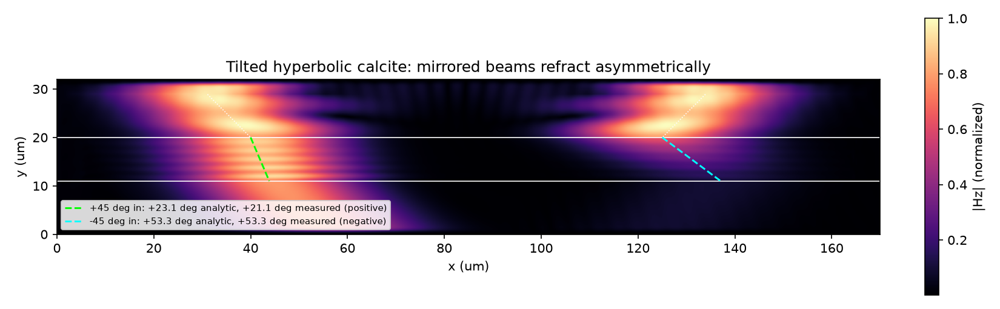
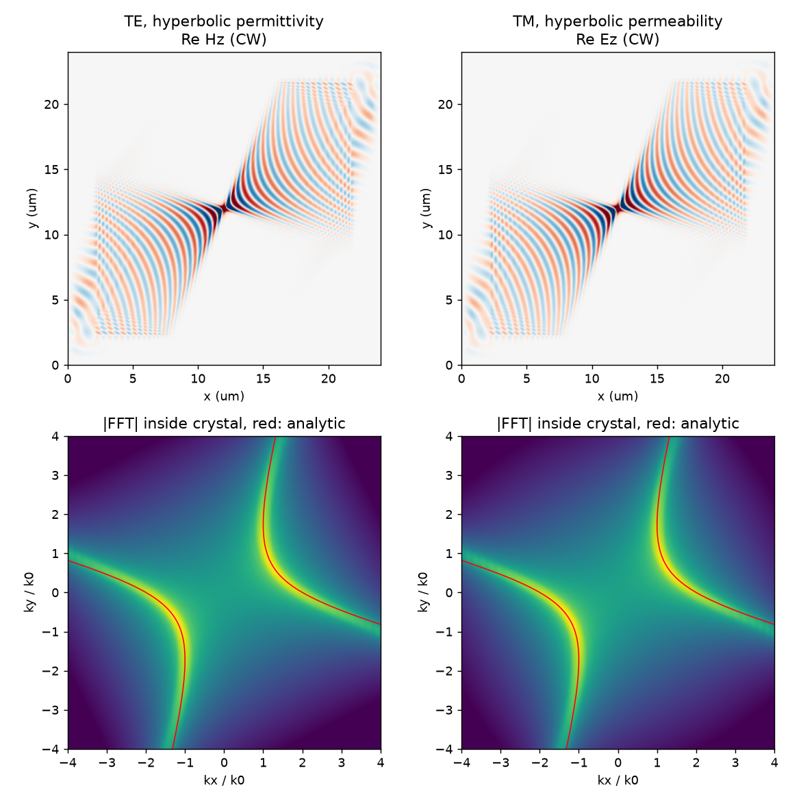
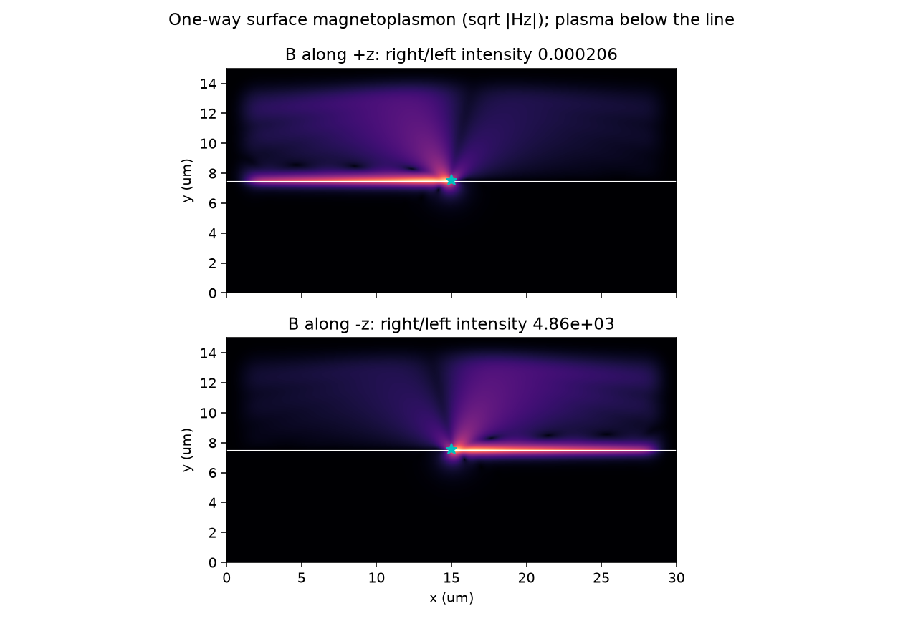

# Anisotropic, Hyperbolic, and Gyrotropic Media

`bz.AnisotropicMedium` describes a material with full symmetric permittivity and
permeability tensors. Resonances can make either tensor dispersive:

- `bz.TensorPole` adds a Lorentz or Drude resonance with a tensor strength.
- `bz.GyrotropicPole` adds a non-reciprocal resonance, for example a magnetized
  plasma.

Together they cover grid-aligned and tilted crystals, magnetic anisotropy,
hyperbolic media whose principal values have opposite signs, and magneto-optic
or plasma media with non-symmetric tensors.

```python
import numpy as np
import beamz as bz

omega = 2 * np.pi * bz.LIGHT_SPEED / (1.5 * bz.um)

crystal = bz.AnisotropicMedium(
    permittivity=2.0,                      # eps_inf: scalar, 3, 6 packed, or 3x3
    permeability=1.0,                      # mu_inf: same forms
    electric_poles=[
        bz.TensorPole.drude((2 * omega, 0.0, 0.0), damping=0.01 * omega),
    ],
)
tilted = crystal.rotated((0.0, 0.0, np.radians(30)))  # Rz(30 deg) @ crystal @ Rz^T
print(tilted.permittivity_tensor(omega / (2 * np.pi)).real)

plasma = bz.AnisotropicMedium(
    electric_poles=[
        bz.GyrotropicPole.magnetized_plasma(
            plasma_frequency=omega, cyclotron=(0.0, 0.0, 0.4 * omega), damping=1e12
        )
    ]
)
```

## Model

With the `exp(-i omega t)` convention, a medium's permittivity is

```text
eps(omega) = eps_inf + sum_p W_p / (omega_p^2 - omega^2 - i gamma_p omega)
```

The permeability follows the same form through `magnetic_poles`.

**Tensor poles.** Each strength `W_p` is a symmetric positive-semidefinite
tensor, so the medium is passive.

- `TensorPole.lorentz(delta_epsilon, resonance=..., damping=...)` sets
  `W = delta_epsilon * resonance^2`.
- `TensorPole.drude(plasma_frequency, damping=...)` has zero resonance and
  `W = plasma_frequency^2`, per axis.

**Gyrotropic poles.** The current precesses about a gyration vector:
`p'' + gamma p' + omega_p^2 p = W F + gyration x p'`. The susceptibility is then
Hermitian when lossless but not symmetric, so the medium is non-reciprocal.
`GyrotropicPole.magnetized_plasma` uses the cyclotron vector `e B / m`.
`GyrotropicPole.lorentz` builds a magneto-optic oscillator.

**Rotation.** `rotated(R)` transforms every tensor as `R T R^T` and every
gyration vector as `R g`. Rotating per-axis poles produces frequency-dependent
off-diagonal terms (oriented poles), which a grid-aligned diagonal model cannot
represent.

A static negative permittivity is unconditionally unstable in FDTD, so
`eps_inf` and `mu_inf` must be positive definite. The negative branch of a
hyperbolic medium has to come from a pole.

## Non-symmetric tensors and conductivity tensors

`permittivity`, `permeability`, `conductivity`, and `magnetic_conductivity`
each accept a scalar, three diagonal values, six packed symmetric values
`(xx, yy, zz, xy, xz, yz)`, nine row-major values, or a 3x3 matrix. A full
matrix may be non-symmetric:

- **Conductivity tensors.** `conductivity` (S/m) and `magnetic_conductivity`
  (Ohm/m) may be any real 3x3 tensor whose symmetric part is positive
  semidefinite. The symmetric part is loss; the antisymmetric part is
  lossless and non-reciprocal, like a Hall response. Rotating a medium now
  rotates its conductivities too.
- **Non-symmetric `eps_inf` or `mu_inf`.** A real non-symmetric tensor is
  non-Hermitian, so it exchanges energy with the field (gain or loss), and
  BeamZ warns. Its symmetric part must be positive definite.

`AnisotropicMedium.from_complex_permittivity(eps, frequency=... or
wavelength=..., permeability=mu)` mirrors fdtdx's constructor of the same
name. It takes a complex scalar, three values, or a 3x3 tensor for each. The
real parts become the tensors, and the imaginary parts become
`sigma = omega0 eps0 Im(eps)` and `sigma_m = omega0 mu0 Im(mu)`, element by
element. `complex_permittivity(f)` and `complex_permeability(f)` return
`eps_inf + chi(f) + i sigma / (omega eps0)`, so they reproduce the input
exactly at the reference frequency. A Hermitian tensor (imaginary
off-diagonals) becomes an antisymmetric conductivity. That gives a lossless
gyrotropic response at `omega0`, scaling as `omega0 / omega` away from it,
which is the causal response of a conductor. For a response matched across a
band, use a `GyrotropicPole`.

```python
medium = bz.AnisotropicMedium.from_complex_permittivity(
    ((2.25, 0.3j, 0.0), (-0.3j, 2.25, 0.0), (0.0, 0.0, 2.25)),
    wavelength=1.55e-6,
)
```

**Update.** Around these media, a cropped box with a two-cell halo takes the
full semi-implicit update

```text
(T + B) F_new = (T - B) F_old + inc,   B = sigma dt / (2 eps0)  (mu0 for H)
F_new = F_old + (T + B)^-1 (inc - 2 B F_old)
```

`inc` is the vacuum kernel's increment, including CPML terms; sources inject
afterwards, as in any other medium. The E kernel runs with vacuum
coefficients inside the box (the H kernel always does), and the box then
applies the full tensors. Each Yee support inverts
its own full `T + B`. Diagonals stay on the sites, and the symmetric and
antisymmetric cross terms sit on the shared support, as in the symmetric
full-tensor update. `B F_old` uses the same collocation. For an antisymmetric
`B` this is a Cayley transform: a uniform field rotates at constant
`E^T eps E`. Plane waves see `T + i cot(omega dt / 2) B`, which tends to
`eps' + i sigma / (omega eps0)` as `omega dt -> 0`.

**Rasterization.** The raster keeps the symmetric `eps_inf` and `mu_inf` and the
diagonal electric conductivity, with the usual smoothing. The antisymmetric
tensor parts, the off-diagonal electric conductivity, and the whole magnetic
conductivity are volume-averaged by each medium's cell fraction on every
support.

**Support.** These media run on JAX (2D and 3D) and on single-device
`backend="cuda_streamed"`, whose native inverse kernel carries the
antisymmetric cross terms. Tensor poles in the same medium use the full
inverse. The following are rejected:

- mode sources and mode monitors that overlap these media;
- 2D simulations with `xz` or `yz` terms;
- `TopologyProblem` designs in the same simulation.

Other off-diagonal permittivity must stay at least three cells away.

## Material library

`beamz.material_library.anisotropic_library` bundles four crystals. Each one is
given in its crystal frame; use `rotated()` to place it in a device.

| Key | Variant | Frame | Source |
| --- | --- | --- | --- |
| `Al2O3` (sapphire) | `Malitson1972` | uniaxial, optic axis z | Exact Sellmeier conversion, refractiveindex.info (CC0) |
| `LiNbO3` (congruent) | `Zelmon1997` | uniaxial, optic axis z | Exact Sellmeier conversion, refractiveindex.info (CC0) |
| `hBN` | `Caldwell2014` | c axis z, mid-IR | Published TO-LO model, Nat. Commun. 5, 5221 |
| `MoO3` (alpha) | `AlvarezPerez2020` | x=[100], y=[001], z=[010] | Published factorized model, Adv. Mater. 32, 1908176 |

Two of these need a note:

- **hBN.** Caldwell et al.'s supplementary table prints its optical-axis labels
  swapped relative to the paper's own main text. BeamZ uses the physical
  assignment: in-plane 1360/1614 1/cm, c axis 760/825 1/cm.
- **alpha-MoO3.** The x axis has three coupled oscillators with unequal damping.
  A sum of Lorentz poles reproduces that factorized form to about 1% (median),
  so each variant's `fit` records its deviation.

`scripts/build_anisotropic_library.py` rebuilds the catalog from the bundled
sources.

## Discretization

Static `eps_inf` tensors use BeamZ's full-tensor electric update. The other
terms run as exact corrections around the standard kernels:

- **Permeability.** The H kernel advances in vacuum. Inside a cropped box around
  the magnetic media, the increment is then mapped through `mu^-1`.
- **Tensor poles.** A normalized polarization `p = P / eps0` follows an explicit
  central-difference recurrence driven by the previous field. The field is then
  corrected by `-eps_inf^-1 (p_new - p_old)`. Magnetic poles mirror this on H.
- **Gyrotropic poles.** Each component's polarization lives on its own Yee
  site, so the strongly negative diagonal response of a plasma stays exact at
  every wavevector. Only the precession couples components. It is integrated
  with Crank-Nicolson and energy-neutral coupling.

Cross terms live on a shared support: primal nodes for E, cell centres for H.
They are reached with reciprocal averaging, which is the volume-weighted
adjoint of its reverse. At material boundaries, a site's diagonal pole weight
is the shared weight averaged back to that site. This makes every discrete pole
operator symmetric positive semidefinite, which keeps lossless hyperbolic
(Drude) media stable at tilted, finite interfaces.

Periodic and Bloch seams average across the seam with the seam's phase, for
both these operators and the full-tensor permittivity kernel. Conductive and
sponge losses enter the tensor updates semi-implicitly as `(T + sigma dt / 2)^-1`.

## Timestep

The explicit pole recurrence is stable when

```text
S^2 + (Omega dt / 2)^2 < 1
```

In this condition:

- `S` is the Courant number inside the medium, normalized to its CFL limit.
- `Omega` is the fastest coupled normal-mode frequency of the medium's poles.

Compilation rejects a timestep that violates this and reports the largest
stable `dt`. Sellmeier crystals with ultraviolet poles, such as LiNbO3 and
sapphire, need a Courant number noticeably below the vacuum limit. Use
`beamz.simulation.anisotropic.max_stable_timestep` to compute the bound in
advance.

Ultraviolet poles sit far above optical bands, yet they set this limit.
`medium.fold_fast_poles(max_resonance)` replaces every pole resonating above
`max_resonance` (rad/s) with a static `eps_inf` shift plus a slower pole at
`max_resonance`:

```text
W' = W (w1 / w0)^4,   delta eps_inf = (W / w0^2) (1 - w1^2 / w0^2)
```

The folded medium matches the original susceptibility and its `omega^2` slope
at low frequency and stays passive. It allows a larger timestep. Choose
`max_resonance` well above the simulated band; compilation suggests it when a
timestep is rejected.

## Boundaries

- **PML.** A PML stretches coordinates. That amplifies the backward waves of
  hyperbolic (indefinite) media, which shows up as late-time exponential growth
  inside the absorber. BeamZ warns when such a medium overlaps a PML.
- **Absorber.** `bz.Absorber`, a graded-loss sponge, absorbs backward waves. It
  works with full permittivity tensors, permeability tensors, and all poles. Use
  it when a hyperbolic or gyrotropic medium has to reach the domain edge.

## Ports, monitors, and gradients

- **Mode sources and monitors in pole media.** Ports inside tensor-pole media
  solve their modes at each frequency with the poles folded in:
  `eps_inf + Re chi(f)`, and likewise `mu(f)` for magnetic poles. Broadband
  sources fold at every profile frequency; mode monitors fold at every monitor
  frequency. The folding data is kept in result archives.
- **Magnetic media at ports.** 3D ports reproduce diagonal and full symmetric
  permeability tensors with the propagation's discretization (diagonals on the
  H sites, cross terms at cell centres). 2D ports support diagonal permeability.
- **Not yet supported at ports.** Gyrotropic media, and 2D TM ports that overlap
  in-plane (`xy`) magnetic coupling.
- **Gradients.** `Simulation.differentiable()` and `TopologyProblem` (default
  autodiff backend) differentiate through every correction on JAX. Fixed tensor
  media must not overlap a design region, including their two-cell halo. The
  spectral-adjoint backend is rejected.
- **Anisotropic design materials.** `TopologySpec(material_min=...,
  material_max=...)` takes `Material` or `AnisotropicMedium` endpoints, for
  example a tilted LiNbO3 crystal against air. The high-frequency tensor blends
  linearly with density, and each endpoint's poles fill a cell with volume
  fraction `rho` or `1 - rho`. Design materials must be nonmagnetic and
  lossless apart from their poles.
- **Multi-material design regions.** `TopologySpec(materials=(m0, m1, m2,
  ...))` picks one of K >= 2 materials per cell; see below.

## Multi-material design regions

A design region can choose among K >= 2 materials. Each may be an isotropic
`Material`, a static tensor, or a pole-dispersive `AnisotropicMedium`:

```python
import beamz as bz
from beamz.material_library import anisotropic_library
from beamz.optimization import TopologyProblem, TopologySpec

lnbo3 = anisotropic_library["LiNbO3"]["Zelmon1997"].rotated((0.0, 0.0, 0.4))
topology = TopologySpec(
    design=design,
    region_mask=mask,
    resolution=dx,
    filter_radius=0.1e-6,
    materials=(bz.Material(1.0), bz.Material(2.1), lnbo3, bz.Material(12.1)),
)
problem = TopologyProblem(simulation, topology, objective)
density = topology.initial_state().density  # shape (3, *mask.shape)
value, gradient = problem.value_and_grad(density, beta=4.0)
```

**Parametrization.** The density has `K - 1` nested channels `c_1, ...,
c_{K-1}`, so its shape is `topology.density_shape == (K - 1, *mask.shape)`.
Channel `c_k` answers one question for the cells already past material
`k - 1`: is the cell material `k - 1`, or material `k` or a later one? The
fraction holding material `k` or a later one is `Q_k = c_1 ... c_k`, and
material `k` alone has weight `w_k = Q_k - Q_{k+1}`, so

    eps_inf = m_0 + sum_k Q_k (m_k - m_{k-1}) = sum_k w_k m_k.

Every channel goes through the same filter, projection and morphology as a
two-material density. The weights are nonnegative and sum to one. Binary
channels select exactly one material, so beta continuation drives every cell
to a single material. With K = 2 there is one channel, and
`materials=(a, b)` is identical to `material_min=a, material_max=b`.

**Physics.** The high-frequency tensors, including their off-diagonals, blend
linearly. Every material's poles fill the cell with volume fraction `w_k`,
which generalizes `rho` and `1 - rho`. Identical pole media listed twice share
one pole region. At runtime the inverse tensors and pole strengths are
rebuilt from the traced density, so the default autodiff backend
differentiates through every path. The spectral-adjoint backend is rejected.

**Ordering.** Order matters. `m_0` is the void: `fixed_void`, the region
background on export, and `eps_min`. `m_{K-1}` is the solid: `fixed_solid`,
the filter context of fixed structures outside the region, and `eps_max`.
List the cladding first and the waveguide core last; `eps_min < eps_max` is
required. Only `c_1` has to change for a cell to go from `m_0` to `m_2`, so
the transition need not pass through `m_1`. However, a channel stops
receiving gradient where an earlier channel is exactly zero, so start from
interior values. The default start (every channel at 0.5) weights earlier
materials more heavily: 1/2, 1/4, and so on.

**Scope.** Multi-material regions are available through `TopologySpec` and
`TopologyProblem`. `TopologyDesignRegion` and `InverseDesign` keep their
scalar `eps_bounds` and two materials. `TopologySpec.apply_gradient`, which
maps a scalar permittivity gradient, rejects K > 2; use
`apply_parameter_gradient`.

**Export.** `TopologyProblem.export_design` lays the region down in `m_0`.
It then paints `m_1, ..., m_{K-1}` in order where `Q_k` exceeds the
threshold, so binarized designs export exactly with their real (anisotropic)
materials.

**Comparison with fdtdx.** fdtdx sorts materials by permittivity and maps one
latent per cell onto that ordered axis. With more than two materials, its
`ClosestIndex` snaps every cell to the nearest material and uses a
straight-through gradient, and continuous blends exist only for two
materials. The BeamZ channels stay continuous and differentiable for any K,
and impose no ordering by permittivity. A single ordered index puts an `m_1`
layer into every grey `m_0`/`m_2` boundary; nested channels do not have to.

## Requirements and limitations

- These media run on JAX (CPU or GPU) and on single-device
  `backend="cuda_streamed"`. Streamed CUDA advances the vacuum fields with its
  native phases and applies the pole and inverse-tensor corrections with the
  native `beamz_cuda_tensor_media` kernels. Fused multi-step schedules
  (`cuda_mstep`, `schedule="mstep"`) and sharded runs are rejected, as are
  CUDA gradients through these media. Gyrotropic poles, Bloch (complex) fields,
  and boxes spanning a periodic seam keep their corrections in JAX inside the
  streamed run.
- Tensor-media executables compile without XLA command buffers, because XLA
  0.9 crashes replaying CUDA graphs of some of these programs.
- Off-diagonal `eps_inf` needs `RasterOptions(smoothing="farjadpour_full")`.
  Off-diagonal permeability or pole tensors also work with `"volume"`.
- 2D simulations require tensors without `xz` or `yz` coupling, and gyration
  along z.

## Examples

`examples/anisotropic/hyperbolic_asymmetric_refraction.py` launches two mirrored
45-degree beams onto a calcite slab driven in its Reststrahlen band. The optic
axis is tilted 25 degrees above the surface. One beam refracts positively and
the other negatively. Both match the analytic group-velocity directions
(+23 and +53 degrees).



`examples/anisotropic/hyperbolic_isofrequency.py` drives a point source in a
tilted hyperbolic crystal. It uses the same tensor once as a permittivity (TE)
and once as a permeability (TM). The Fourier transforms of the two fields land
on the same analytic hyperbola, as electromagnetic duality requires.



`examples/anisotropic/gyrotropic_oneway_surface_wave.py` launches a surface
magnetoplasmon on a magnetized plasma inside its one-way band. It runs one way
for +B and the other way for -B, and flipping B reverses it.


